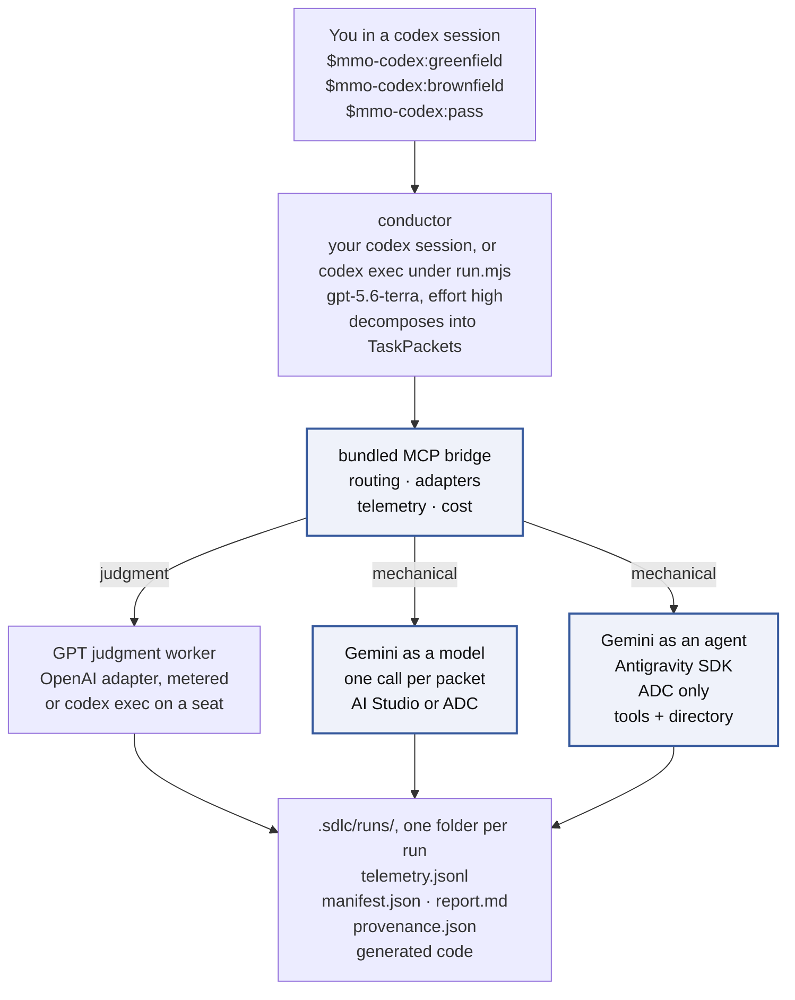
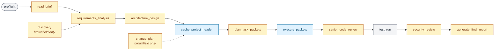
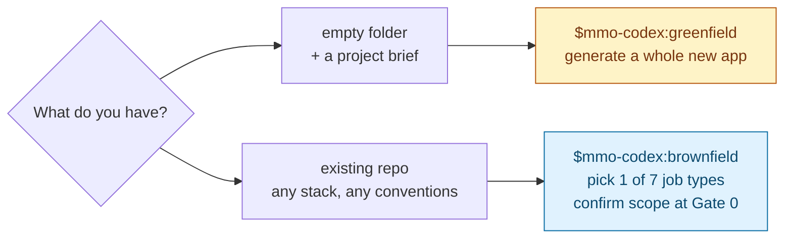

# AI-SDLC Orchestrator — Codex Harness

[](LICENSE)
[](https://github.com/tl-ai-labs/ai-sdlc-orchestrator-codex-harness/actions/workflows/test.yml)
[](.agents/plugins/marketplace.json)

## What this is

A Codex CLI plugin that runs a full SDLC pipeline — requirements → design → code → tests → docs → senior review → security review — against either an empty folder (**greenfield**) or an existing repository (**brownfield**). It routes each phase to the model that fits: judgment work stays on GPT, mechanical work drops to Gemini Flash.

This is a port of the [Claude Code harness](https://github.com/tl-ai-labs/ai-sdlc-orchestrator-claude-code-harness) — same pipeline, same job types, same briefs, driven by the Codex CLI instead. No Anthropic model or credential appears anywhere in the execution path. The carried Anthropic adapters stay compiled and tested but dormant, and the policies naming them are non-selectable replay fixtures, excluded from the picker.

Two ways to pay for the judgment tier reach the same model at the same effort pin — a metered `OPENAI_API_KEY`, or a `codex exec` subprocess on a ChatGPT seat. You pick which once, by choosing a policy. See [Running without an API key](#running-without-an-api-key) for what that costs in reporting precision.

Every generated file, every telemetry event, and every cost report lands under your project directory. Nothing is uploaded off the machine.

## Quick start

You use it in a codex session:

1. **Install.** Paste `Set up this plugin from this repo - https://github.com/tl-ai-labs/ai-sdlc-orchestrator-codex-harness` into a codex session and approve the commands it runs ([INSTALL.md](INSTALL.md)).
2. **Start codex in your project** on the conductor's pin, with the sandbox dispatch needs: `codex -s danger-full-access -m gpt-5.6-terra -c model_reasoning_effort="high"`. When codex asks about the plugin's hook, choose "Trust all and continue"; brownfield runs need it.
3. **Set up the project** with `$mmo-codex:setup`, which checks credentials and records the project's policy.
4. **Start a run.** `$mmo-codex:greenfield` builds a new app from a brief in an empty folder. `$mmo-codex:brownfield`, or a job alias such as `$mmo-codex:bugfix POST /login returns 500 when the password is missing`, works on an existing repository.
5. **Answer the gates** in the chat: `approved`, `revise: <what to change>` or `abort`, and `accept` at the end. The run's record is `.sdlc/runs/<run-id>/`, and its cost report is `report.md` there.

The walkthrough is [docs/tutorial-first-run.md](docs/tutorial-first-run.md). To check the cost figures against codex's own token count, run the same pipeline headlessly: [docs/headless-runs.md](docs/headless-runs.md).

## Architecture

### System dataflow



The highlighted path is where cost drops — mechanical work routed off the judgment tier into the cheaper one. Which door the mechanical tier uses (model vs agent) is picked once at setup; both reach the same model at the same published rates.

Unlike the Claude harness, the model never calls the bridge as a tool. A model inside codex has no per-tool binding for an MCP server, so the conductor dispatches by running `plugin/codex/dispatch.mjs`, a shell command that opens the MCP connection itself — see [docs/verification/p1-codex-runtime.md](docs/verification/p1-codex-runtime.md).

### Phase timeline

A greenfield run walks 11 states in order. Brownfield inserts two more (`discovery`, `change_plan`) around the same core. Each state is color-coded by which tier does the work.



Legend — **amber:** GPT (judgment). **blue:** Gemini Flash (mechanical). **grey:** local — no model call.

Four HITL gates fire along the way: after requirements (Gate 1), after design (Gate 2), after security review (Gate 3), before final acceptance (Gate 4). Brownfield adds Gate 0 (discovery confirmation) before any of them.

The state machine in full is in [plugin/skills/pipeline/SKILL.md](plugin/skills/pipeline/SKILL.md).

## What it can do

### Tasks — the seven brownfield job types

Pick one at Gate 0 in `$mmo-codex:brownfield`.

| Job type | When to use | Who does the heavy lifting |
|---|---|---|
| `docs` | Write API docs, README, ADRs, docstrings | Gemini Flash |
| `bugfix` | Fix a specific defect (reproduce → diagnose → fix → regression test) | Gemini Flash · escalates to GPT after 2 failed retries |
| `feature-extend` | Add a capability to an existing endpoint or module | GPT for change plan · Gemini for the edits |
| `feature-new` | Add a new subsystem (endpoint + storage + tests) | GPT for design · Gemini for full codegen mix |
| `refactor` | Extract shared logic; runs the **full** test suite for invariants | GPT for refactor plan · Gemini for `refactor_extract` + patches |
| `test` | Backfill tests to a coverage target | Gemini Flash |
| `deps` | Upgrade a dependency + patch breaking-change fallout | GPT for dep-swap plan · Gemini for adjacent-code patches |

The intent-by-phase matrix is in [plugin/skills/pipeline/SKILL.md](plugin/skills/pipeline/SKILL.md).

### Routing — model per phase

Same rule applies to greenfield and brownfield. The default `gpt-plus-flash` policy routes:

| Phase | Tier | Model in the default policy |
|---|---|---|
| `requirements_analysis` · `architecture_design` · `plan_task_packets` | judgment | `gpt-5.6-terra`, effort `high` |
| `senior_code_review` · `security_review` | judgment | `gpt-5.6-terra`, effort `high` |
| `discovery` · `change_plan` (brownfield only) | judgment | `gpt-5.6-terra`, effort `high` |
| `codegen` · `tests` · `docs` (the `execute_packets` step) | mechanical | Gemini 3.7 Flash |
| `debug` | mechanical | Gemini 3.7 Flash |
| `codegen` · `tests` · `docs` · `debug` with `retry_count` ≥ 2 | judgment | `gpt-5.6-terra` (auto-escalation) |
| `test_run` | local | Bash on your machine, no model call |

Source: [plugin/config/policies/gpt-plus-flash.yaml](plugin/config/policies/gpt-plus-flash.yaml). Every rule is data — change routing by editing the YAML, or author a new policy in the browser console via `$mmo-codex:policy change`.

Two guardrails ship on:

- **Escalation** — a mechanical-tier packet that fails validation twice auto-routes to GPT on the third attempt. Prevents infinite retries when Flash cannot solve a particular puzzle.
- **Hard cost cap** — `$50` per run (`hard_cost_cap_usd` in the policy). The cap counts the dispatched cost in the run's `telemetry.jsonl` plus the conductor's own modeled cost from the same run folder. Once that total reaches the cap, the bridge refuses every further dispatch and `run.mjs` stops resuming. The call that crosses the cap still completes, and the conductor's current turn still runs, so a run can overshoot by part of one turn. A conductor on a model other than the policy's pin is not priced and adds $0. Raise the cap, or delete the key for no cap, in your own policy.

Four policies ship as selectable:

| Policy | Judgment tier | Mechanical tier | Cost reporting |
|---|---|---|---|
| `gpt-plus-flash` (default) | GPT via the OpenAI API | Gemini Flash | Every dispatch vendor-metered; the conductor's line modeled — the policy of record |
| `gpt-plus-flash-38` | GPT via the OpenAI API | Gemini 3.8 Flash | Every dispatch vendor-metered; the conductor's line modeled |
| `gpt-seat-plus-flash` | GPT via local `codex exec` on a ChatGPT seat | Gemini Flash | Judgment cost is **modeled**, not metered |
| `flash-agsdk-only` | Gemini Flash via the agent worker | Gemini Flash via the agent worker | Every dispatch on the agent door; the conductor still runs on the GPT pin |

The driver and judgment legs are both GPT but are **not** the same call path: the conductor runs on the codex CLI's own login, while judgment work dispatches through the bridge as metered API calls on `OPENAI_API_KEY`, one telemetry row each. That separation is deliberate — it is what keeps per-phase cost attribution honest.

### Running without an API key

With a ChatGPT subscription and no `OPENAI_API_KEY`, select the subscription policy:

```bash
node plugin/scripts/setup-policy.mjs --policy=gpt-seat-plus-flash --project-root "$(pwd)"
```

It routes judgment work through a local `codex exec` subprocess on your seat instead of the metered API. Same model, same effort pin, same routing rules.

**The trade-off is in the cost figures, not the output.** Codex reports token counts but no cost, so judgment-tier cost becomes modeled rather than metered — telemetry labels those events `modeled`, and the run report keeps them out of the vendor total. Use `gpt-plus-flash` for anything whose cost numbers get published; use `gpt-seat-plus-flash` to develop, or to run at all without a key. A full run then draws judgment work from the same monthly seat allowance as the conductor.

## Greenfield vs. brownfield



| Mode | Skill | What it does |
|---|---|---|
| **Greenfield** | `$mmo-codex:greenfield` | Generates a whole new application from a project brief into `./src/`. Original flow the pipeline was built for. |
| **Brownfield** | `$mmo-codex:brownfield` | Extends an existing repository. Pick one of the seven job types above, confirm scope at Gate 0, run the pipeline with a non-destructive write contract that keeps off-limits files untouched. |

Both use the same install, same policies, same MCP dispatch layer.

## Prerequisites — what you actually need

Framed by what you want to do, not by every provider that exists. The full matrix — env vars, verify commands, failure modes — is in [SETUP.md](SETUP.md).

| If you want to… | You need |
|---|---|
| **Try it at all** | Node.js 20+, Codex CLI 0.151.0+ logged in (`codex login`), git 2.30+, macOS/Linux/WSL2, and either an `OPENAI_API_KEY` **or** a ChatGPT seat with the `gpt-seat-plus-flash` policy |
| **Get the cost drop on mechanical work** | The above, plus a Gemini surface — a `GEMINI_API_KEY` from [AI Studio](https://aistudio.google.com/app/apikey), or Application Default Credentials from `gcloud auth application-default login` |
| **Use the Antigravity agent path** | The above, plus Python 3.10+ (macOS ships 3.9, too old) **and** Vertex ADC — there is no API-key door for the agent path |

You do not need to pick a Gemini door yourself — setup asks. You do not need to write a policy — `gpt-plus-flash` loads by default.

## Setup — ask for it in plain words

Nothing to clone, nothing to type by hand. Paste this into a codex session:

```
Set up this plugin from this repo - https://github.com/tl-ai-labs/ai-sdlc-orchestrator-codex-harness
```

Codex follows [INSTALL.md](INSTALL.md): registers the marketplace, installs the plugin, builds the bundled MCP server, checks credentials, asks which policy this project should use, and reports where things stand. Approve the commands it asks to run — marketplace registration needs network, which the sandbox otherwise blocks.

For a run, start a new session the way the next note says. Codex asks about the plugin's write hook when a session starts, and the run itself needs the sandbox and model flags.

Prefer to drive it yourself:

```bash
codex plugin marketplace add https://github.com/tl-ai-labs/ai-sdlc-orchestrator-codex-harness.git
codex plugin add mmo-codex@tilicho-ai-labs
node "$(ls -d ~/.codex/plugins/cache/tilicho-ai-labs/mmo-codex/*/codex/verify-setup.mjs | tail -1)" --fix --project-root "$(pwd)"
```

`--fix` installs the bridge's dependencies and compiles it — `dist/` is not tracked, so a fresh install cannot dispatch until it is built. Credentials, the Gemini door choice, and the policy picker are covered step by step in [SETUP.md](SETUP.md).

> **Start codex the way a run needs it.** The bridge is reached by spawning it and talking over pipes, and codex's sandbox denies piped stdio under both its default and `workspace-write` modes, so start codex with `-s danger-full-access`. A run also starts only in a session on the conductor's pin, `gpt-5.6-terra` at effort `high`: `codex -s danger-full-access -m gpt-5.6-terra -c model_reasoning_effort="high"`, or `/model` in a session already open.

## Commands

The workflow ships as 13 Codex skills you invoke, plus two playbooks (`pipeline` and `brownfield-guide`) that a run renders into its own folder and follows; you never invoke those two. In a codex session, type `$` to mention a skill, or `/skills` to browse. Custom prompts are deprecated in codex, so there is no `/mmo:*` slash-command surface — the reasoning is recorded in [docs/verification/p1-codex-runtime.md](docs/verification/p1-codex-runtime.md).

### Run the pipeline

| Skill | What it does | When to use it |
|---|---|---|
| [`$mmo-codex:greenfield`](plugin/skills/greenfield/SKILL.md) | Runs the greenfield pipeline. Interviews you for the brief (or reads one you point at), confirms the output path, shows the routing plan, then starts spending. Takes no arguments. | Empty folder + a project brief. Generates a whole new app into `./src/`. |
| [`$mmo-codex:brownfield`](plugin/skills/brownfield/SKILL.md) | Runs the brownfield pipeline. Hydrates prior state, runs discovery (or resumes), asks for the intent and brief, freezes scope at Gate 0, then executes. Takes no arguments. | Existing repo. Extends the code you already have. |
| [`$mmo-codex:pass`](plugin/skills/pass/SKILL.md) | Flag-driven twin of the above: `--brief`, `--policy`, `--gates`, `--intent`, `--run-id`, and more. In a session it starts the run itself; from a shell the same flags drive `plugin/codex/run.mjs`. | Scripted replays, CI. |

### Run a specific brownfield job

Seven aliases into `$mmo-codex:brownfield`, each with the job type pre-selected — one shared manual, one Gate 0, no second pipeline. An optional free-text argument seeds the brief; Gate 0 still fires and still re-confirms scope either way.

| Skill | Job type | Example |
|---|---|---|
| [`$mmo-codex:docs`](plugin/skills/docs/SKILL.md) | `docs` | write API docs, README, ADRs, docstrings for the auth module |
| [`$mmo-codex:bugfix`](plugin/skills/bugfix/SKILL.md) | `bugfix` | fix the /login endpoint returning 500 on missing password |
| [`$mmo-codex:feature-extend`](plugin/skills/feature-extend/SKILL.md) | `feature-extend` | add a `?filter` param to the existing /users endpoint |
| [`$mmo-codex:feature-new`](plugin/skills/feature-new/SKILL.md) | `feature-new` | add a webhooks module (endpoint, storage, retry loop) |
| [`$mmo-codex:refactor`](plugin/skills/refactor/SKILL.md) | `refactor` | extract shared date logic into a util module and update all call sites |
| [`$mmo-codex:test`](plugin/skills/test/SKILL.md) | `test` | backfill unit tests for src/payments to reach 80% line coverage |
| [`$mmo-codex:deps`](plugin/skills/deps/SKILL.md) | `deps` | upgrade jest 28 → 29 (and adapt breaking changes) |

These and `pass` are invoke-only: they start a full billable run, so they never fire on their own from a matching phrase.

### Setup and configuration

| Skill | What it does | When to use it |
|---|---|---|
| [`$mmo-codex:setup`](plugin/skills/setup/SKILL.md) | Rebuilds the MCP server, re-checks credentials, pauses only when a human decision is genuinely needed (missing credential, Gemini door choice, policy pick). Idempotent. | After a plugin update, a credential change, or an unexpected refusal. Also the everyday "did I set this up right?" check. |
| [`$mmo-codex:policy`](plugin/skills/policy/SKILL.md) | Bare: prints this project's `default_policy`, and names the `routing-policy.yaml` that overrides it when one sits at the project root. `change`: terminal picker, with an option to author a new one in the browser. `--policy=<name>`: silent set, no browser. Per-project — writes `.sdlc/project.json.default_policy`. | Check or change which policy this project uses. |

### Undo

| Skill | What it does | When to use it |
|---|---|---|
| [`$mmo-codex:revert`](plugin/skills/revert/SKILL.md) | Reads `.sdlc/runs/<run-id>/provenance.json` and restores each touched file to its pre-run state — git checkout for tracked-committed files, per-run backup for uncommitted ones. When a file changed after the run, or close-out found a change no snapshot saw, it shows the diff and asks before touching that file. | Undoing a specific brownfield run. |

Installed as a plugin, these work everywhere with no extra step. Working **inside a clone** of this repo, codex scans `.agents/skills` rather than the `plugin/skills/` directory they ship in, so run `node plugin/codex/verify-setup.mjs --fix` once to link them.

## Check the cost with a headless run

In a codex session, the conductor's cost is read from codex's session file at the run's end. A headless run checks that reading: `plugin/codex/run.mjs` drives the same pipeline from a shell with `codex exec --json`, and at the run's end the harness compares codex's own per-turn token counts with what the session-file reader computes, token for token. From the root of a clone, with the bridge built (`node plugin/codex/verify-setup.mjs --fix`), this runs the quick-demo brief into a project folder of its own:

```bash
mkdir -p ~/mmo-runs/ping
node plugin/codex/run.mjs \
  --brief=examples/quick-demo/brief.md \
  --project-root="$HOME/mmo-runs/ping" \
  --mode=greenfield \
  --policy=gpt-plus-flash \
  --gates=auto-approve
```

Add `--dry-run` to see the pinned invocation without spending anything. The run's record lands in `~/mmo-runs/ping/.sdlc/runs/<run-id>/`, with the cost report in `report.md` there and the token comparison under its driver figure. The report prints `Run total = dispatched + driver` and splits it into a **vendor-metered** total and a **modeled** total. Codex reports no wallet figures at all, so the driver leg's cost can only be derived from token counts at the dated price list's rates — and a driver running on a seat may have cost nothing in money. That is why the modeled figure never enters the vendor-metered total.

Every step, from the API-key login to the OpenAI usage dashboard check, is in [docs/headless-runs.md](docs/headless-runs.md). Every flag is in [docs/running.md](docs/running.md).

## What a run produces

Each run's record lands in its own folder, `.sdlc/runs/<run-id>/`. Generated source lands under `./src/` (greenfield) or in place (brownfield). The project-level state shared by every run stays in `.sdlc/` itself.

| File | Contents |
|---|---|
| `runs/<run-id>/telemetry.jsonl` | One JSON line per model call: phase, model, tokens (input / cached / output), cost, latency, task_id. |
| `runs/<run-id>/manifest.json` | Rollup of the telemetry, written by `plugin/scripts/write-manifest.mjs`: totals, per-phase, per-module, per-task-type. |
| `runs/<run-id>/gates.jsonl` | One line per gate decision. |
| `runs/<run-id>/driver-usage.json` | The conductor's own tokens and modeled cost, read from codex's session file at the run's end. |
| `runs/<run-id>/report.md` | The cost report, written at the run's end. |
| `runs/<run-id>/provenance.json` | Brownfield: every file the run touched, with pre-run hash — the input `$mmo-codex:revert` reads. |
| `local/guard-decisions.jsonl` | One line per hooked call while a brownfield contract binds, allow or deny; outside a run, one line per refusal, and only in a project that already has `.sdlc/`. A denied call leaves no trace in the Codex event stream, so this file is the only record of it. |
| `runs/<run-id>/delegation/` | Only on runs that used the agent path. Three files per delegated packet: task brief, worker usage sidecar, receipt. |
| Cost report | `report.md` in the run folder, or `node plugin/scripts/report.mjs .sdlc/runs/<run-id>` from a clone — per-phase table, delegation table if any, the run total with its vendor-metered and modeled parts, methodology footer. |

How the numbers are derived is in [docs/methodology.md](docs/methodology.md).

## Brownfield mode: what the write contract actually guarantees

Brownfield runs work against an existing repository, so scope is confirmed at a gate and enforced at the tool boundary. Being precise about the guarantee matters more than making it sound strong.

**Where the guard runs.** One hook script judges every `apply_patch` and shell call. It is wired twice from `plugin/hooks/hooks.json`:

| Route | Guarded | Why |
|---|---|---|
| Headless `run.mjs` | Always | `run.mjs` registers the hook for each `codex exec` call and passes `--dangerously-bypass-hook-trust`. |
| Interactive, plugin installed | After you trust the hook once (the startup prompt's "Trust all and continue", or `/hooks`) | Codex skips an untrusted or changed hook without a word. Gate 0 runs `write-contract.mjs --assert-guard-live` and stops the run when no hook decision was recorded; a resumed run runs it again before its first write. |
| Interactive, from a clone without installing | No | Nothing registers the hook. |
| A judgment dispatch on the seat policy (a nested `codex exec`) | No | The worker runs in a read-only sandbox, and the bridge switches the plugin's hook off for it. |

**What is enforced.** Gate 0 freezes the contract with `write-contract.mjs --freeze`: it writes `.sdlc/local/write-contract.json`, a byte-for-byte copy in the run's folder, and a lock holding the contract's SHA-256. While the run is live, a write outside the confirmed allowlist, or matching an off-limits pattern, is refused, and the model is told why. The run's own `.sdlc/runs/<run-id>/` folder stays writable, except the lock, the frozen copy, the rendered `skills/`, `provenance.json` and `backups/`. This covers the patch mechanism the model uses by default, also when it runs `apply_patch` through the shell, shell redirects outside quotes (`>`, `>>`, `>|`, `&>` and the rest), every file `tee` names, `touch`, each file a `cp` or `mv` lands on (into a folder too: the hook lists a copied folder's files and judges each one), and `rm`, `unlink` and `mv` sources aimed at the contract or those records. A path the shell expands (a glob, `{a,b}` braces, a quote inside a word, a variable) is refused while a run is live when it may reach one of those records, and a variable the hook cannot read counts as reaching everything below the folder written before it, so such a removal names its path in full. A redirect with no space before the `>` (`echo hi>.env`) reads the same as code such as `a>b`, so it is checked against the always-refused list and those records only. Off-limits names match in any case, and a write through a link is judged where it lands: a link that leads out of the project is a write outside it. Only the contract at the root of the target's git project counts.

**Refused in every session, contract or not.** `.env`, `.env.*`, `.mcp.json`, `.codex/config.toml`, `.codex/auth.json`, `.git/**` and `.agents/**`, at any depth and in any case, and a file named `.git` (a linked worktree's pointer to its store). With no contract binding, a missing `.env`, `.env.example` or `.env.test` may be created, so a fresh project can bootstrap its test fixture. The allowance holds only where the hook knows the folder the file lands in: an `apply_patch` Add File, or a shell write to an absolute path written out literally (no `~`, `$`, backtick, glob or quote inside it), with nothing at that path yet. A relative path in a shell command gets no allowance, because the shell can run it from another folder (see below). Build output, `node_modules/` and `.sdlc/local/` are off-limits only inside a contracted run.

**The contract protects itself.** The model cannot edit the contract while its run is live, and a contract whose bytes no longer match its lock, by any route, makes the hook refuse every write until you end the run with `write-contract.mjs --abandon --run-id=<run-id>`. Close-out (`write-contract.mjs --close`) ends the run and switches the contract off; a contract whose run has ended binds nothing. Every other end of a run does the same with the run's outcome (`run.mjs` at its run end, `end-run.mjs` in a session), and a resume puts the frozen contract back, except for a run that ended `completed` or `aborted`.

**The decision log.** While a contract binds, every hooked call is recorded to `.sdlc/local/guard-decisions.jsonl` with its own timestamp, the run id, and `wired_by` (`run` or `plugin`). A refusal with no binding contract is recorded only when the project already has `.sdlc/`. The hook never creates `.sdlc/` in a repository that has none.

**What is not enforced.** The shell-command scan splits a command as the shell does, but it judges only the commands it knows: redirects, `tee`, `touch`, `cp`, `mv`, `rm`, `unlink`, `git rm`, `git mv` and a shell `apply_patch`. A sufficiently indirect construction — a write performed by a script the model invokes, an interpreter one-liner, an unusual redirect form, a `cd` before a relative write — can fall outside it, and fails open rather than closed. A folder copy whose source the hook cannot list (a variable or glob source, or more than 1,000 entries) is judged as its destination folder, not by the names inside it. A relative path in a shell command is judged from the session folder: Codex's shell tool takes a `workdir` that the hook payload does not carry, so the hook cannot see the folder the command runs in. The guarantee is that ordinary writes are gated and recorded, not that the sandbox is escape-proof. Codex's own sandbox is the outer boundary; this contract is the scope boundary inside it.

## Try it — one worked example

The [Ping Service](examples/quick-demo/) brief run on `gpt-plus-flash`, mechanical phases going to Gemini as a model:

```
Wall-clock:    20 minutes 47 seconds
Recorded cost: $0.5287, vendor-metered
Result:        a working app — GET /ping returns 200, unknown routes 404
```

The recorded figure was priced at Gemini rates of $1.50 / $0.15 / $9.00 per 1M tokens, about 2× Gemini 3.7 Flash's introductory card. The dated price list (`plugin/mcp/model-dispatch/src/prices.ts`) bills Gemini 3.7 Flash at $0.75 / $0.075 / $3.75 through 2026-12-31 and $1.50 / $0.15 / $7.50 from 2027-01-01, so the same run re-priced costs less on either card. The GPT share is unaffected.

That is one run of one small brief, not a guarantee — cost scales with how much code the brief implies and how many times a phase has to be revised. Each run writes its cost report to `report.md` in its folder. From the root of a clone, this renders the report of the latest headless quick-demo run again:

```bash
node plugin/scripts/report.mjs "$HOME/mmo-runs/ping/.sdlc" --markdown
```

The same brief, run step by step in a codex session: [docs/tutorial-first-run.md](docs/tutorial-first-run.md).

## Verify or repair the install

Re-run the setup check any time. It rebuilds the MCP server, re-checks credentials, and reports what is missing with the fix for each:

```bash
node plugin/codex/verify-setup.mjs --fix
```

`$mmo-codex:setup` does the same from inside a codex session, pausing only when a human decision is needed. Both are idempotent, and both are the repair after a plugin update, which removes the build.

## Clone route

For working on the harness itself, rather than using it:

```bash
git clone https://github.com/tl-ai-labs/ai-sdlc-orchestrator-codex-harness.git
cd ai-sdlc-orchestrator-codex-harness
node tools/setup.mjs
```

`tools/setup.mjs` runs the same checks the plugin route runs, installs the MCP server's dependencies, builds it, optionally builds the Python agent worker, and registers the bridge with `codex mcp add`.

## Documentation

- [INSTALL.md](INSTALL.md) — the steps codex follows when asked to set this up in plain words
- [SETUP.md](SETUP.md) — prerequisites, both install routes, credentials, both Gemini doors, the policy pick
- [docs/running.md](docs/running.md) — the pipeline, policies, bringing your own brief
- [docs/brief-template.md](docs/brief-template.md) — the section layout a brief needs
- [docs/tutorial-first-run.md](docs/tutorial-first-run.md) — a greenfield run and a brownfield run in a codex session, from install to the cost report
- [docs/headless-runs.md](docs/headless-runs.md) — check the cost with a headless run: the token cross-check and the OpenAI usage dashboard
- [docs/troubleshooting.md](docs/troubleshooting.md) — symptom → cause → fix, keyed by the message on screen
- [docs/understanding-output.md](docs/understanding-output.md) — reading the cost report and the raw files a run leaves behind
- [docs/architecture.md](docs/architecture.md) — who calls what, adapters, routing, the write contract, telemetry, install routes
- [docs/methodology.md](docs/methodology.md) — how tokens and costs are recorded, and why modeled figures stay out of the vendor-metered total
- [docs/verification/p1-codex-runtime.md](docs/verification/p1-codex-runtime.md) — the Codex runtime capability checks this port is built on, with the pinned model, effort, sandbox and approval values, and the findings that shaped the architecture
- [CONTRIBUTING.md](CONTRIBUTING.md) — branching model, style rules, how to submit
- [examples/quick-demo/](examples/quick-demo/) — smallest brief, one endpoint, minutes to run
- [examples/workforce-ops/](examples/workforce-ops/) — the reference brief
- [examples/travel-ops/](examples/travel-ops/) — a second brief (booking, cancellation, refund handling)

## Status

Every part of the port is built and tested. What is outstanding is a metered reference run, which needs an API key this machine does not have.

| Phase | Work | Status |
|---|---|---|
| P1′ | Codex runtime verification, model/effort pin selection | Done |
| P2 | Repository skeleton, carried engine and support scripts | Done |
| P3 | OpenAI adapter, Codex policy, driver-bridge client, write-contract enforcement | Done |
| P4 | Telemetry reader, denied-call sidecar, fairness pin, setup rebuild, plugin packaging, cost report | Done |
| P5 | Quick-demo run end to end | Done — 20m 47s, working app, $0.5287 metered (at the superseded Gemini rate) |
| P6 | Command surface (15 skills), agent roles, discovery, docs, plugin install | Done |
| P7 | Full Workforce Ops reference run | Running on the seat; **metered** run still needs `OPENAI_API_KEY` |
| P8 | Walkthroughs, console study | Not started |

Findings during the port that changed the design from the original plan, all documented in the verification file: a model inside `codex exec` cannot call the bridge's MCP tools at all, so the driver calls the bridge itself; the write-contract hook must cover the native patch tool, not just shell commands; the default `workspace-write` sandbox blocks the network the bridge needs; custom prompts are deprecated, so the command surface ships as skills; and one `codex exec` turn cannot finish a real project, so the driver resumes the session until the pipeline completes.

## License

MIT — see [LICENSE](LICENSE).

---

<p align="center">
  <a href="https://tilicho.in">
    
  </a>
  <br />
  Built and maintained by <a href="https://tilicho.in">Tilicho</a>.
</p>
