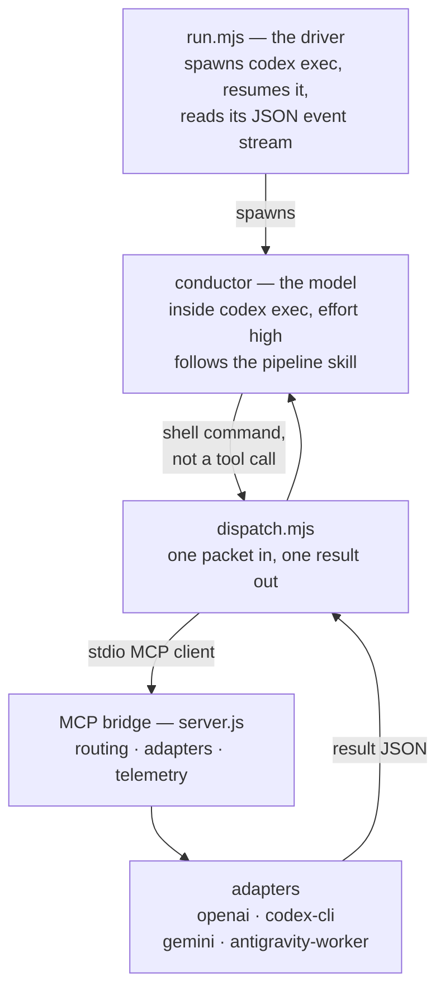

# Architecture

> **For:** understanding how a request flows through the harness, and what each file is for. **Also see:** [running.md](running.md) · [methodology.md](methodology.md) · [verification/p1-codex-runtime.md](verification/p1-codex-runtime.md)

The shape of this harness follows from one measured finding: a model running inside `codex exec` cannot call an MCP server's tools. Everything below is downstream of that.

## 1. Who calls what

In the Claude harness, the orchestrator subagent calls the bundled MCP server as a tool. That is not available here. Check 4 in [verification/p1-codex-runtime.md](verification/p1-codex-runtime.md) found that a model inside a plain `codex exec` session has no per-tool binding for this server — the MCP primitives codex does expose are Resources, and this server implements Tools.

So the driver calls the bridge, and the model never does:

The conductor dispatches by running a shell command. `dispatch.mjs` is an ordinary MCP client that spawns the bridge, calls one tool, and exits. That is why dispatch needs a session permitted to open pipes to a child process — see the sandbox entry in [troubleshooting.md](troubleshooting.md#dispatch-and-the-bridge).

## 2. The driver — `plugin/codex/run.mjs`

Spawns `codex exec` with a pinned model, reasoning effort, sandbox and approval policy, then resumes the same session until the pipeline signals completion.

- **Completion signal.** Phase 9 writes `manifest.json` and `SUMMARY.md`. `SUMMARY.md` is the signal, because only the final phase writes it.
- **Why resuming is normal.** One turn ends when the session hits its context ceiling — exit 0, no error. `--max-turns` (default 12) caps how many turns one run may use.
- **The fairness pin.** The model and effort are read back out of the built `codex exec` argv and asserted against the policy's `driver:` block before spending. A mismatch aborts rather than quietly running a different model than the one the cost figures will be attributed to. See `plugin/codex/telemetry/fairnessPin.mjs`.
- **One policy resolver.** `run.mjs` and `start-run.mjs` resolve their policy through the bridge's `dist/policy.js`. `run.mjs` hands codex the resolved file in `MMO_POLICY_PATH`, which `dispatch.mjs` forwards as `policy_path`. The policy that prices and caps the run is the one every dispatch routes by.
- **The session model check.** In a codex session, `start-run.mjs` reads the session's last `turn_context` from its rollout file (found by `CODEX_THREAD_ID`) and starts no run unless the model and effort match the policy's `driver:` block. See `plugin/codex/session-model.mjs`.

## 3. The bridge — `plugin/mcp/model-dispatch/`

A stdio MCP server. Five tools, unchanged from the Claude harness:

| Tool | Purpose |
|---|---|
| `execute_with_model` | Route one TaskPacket to the model the policy names, and return the result. |
| `preflight_dispatch` | Prove every model this run would dispatch to is constructible, before spending. No API call. |
| `load_policy` | Return the parsed policy the run is operating under. |
| `simulate_policy` | Given the telemetry from a real run, recompute what it would have cost under a different policy. No model calls. |
| `log_telemetry` | Append one event to `telemetry.jsonl`. |

`driverClient.ts` is the client side — it spawns the server, sets a 900-second per-call timeout, and diagnoses a failed connection. The default MCP SDK timeout is 60 seconds, which is far below what a real dispatch at effort `high` takes; that mismatch killed a reference run once and the comment in that file records it.

## 4. Adapters — `plugin/mcp/model-dispatch/src/adapters/`

One per way of reaching a model. A policy names an adapter per model entry.

| Adapter | Reaches | Credential |
|---|---|---|
| `openai` | GPT through the OpenAI API | `OPENAI_API_KEY`, metered |
| `codex-cli` | GPT through a local `codex exec` subprocess | the CLI's own login — a ChatGPT seat |
| `mcp:model-dispatch` → `GeminiFlashAdapter` | Gemini as a model, one completion per packet | `GEMINI_API_KEY` or Google Cloud ADC |
| `antigravity-worker` | Gemini as an agent session with tools and a working directory | Vertex ADC only — no API-key door |

`BuiltinAnthropicAdapter` and `ClaudeCliAdapter` are carried from the source, compiled and tested, and never reached: no selectable policy names them.

The `openai` and `codex-cli` adapters reach the same model. They are separate because they bill differently, and keeping them distinct is what makes per-phase cost attribution honest — one produces metered figures, the other modeled ones.

## 5. Routing — `plugin/config/policies/*.yaml`

Routing is data, not code. Each policy declares `models:` (id, adapter, model name, pricing, auth) and `rules:` (a `when:` clause matched against phase and retry count, and the model to `use:`). First match wins; a bare `when:` is the fallback.

Two guardrails ship on: a mechanical packet that fails validation twice escalates to the judgment tier on the third attempt, and `hard_cost_cap_usd` stops the run once the cost recorded in `telemetry.jsonl` reaches it. The bridge refuses every dispatch after that point (`src/costCap.ts`), and `run.mjs` stops resuming the session and records `cost_cap_stop` in `driver-manifest.json`. The cap counts dispatched work only. Driver cost is modeled after the run from the `codex exec --json` stream, so it is not known while the run is in progress.

The three selectable policies are described in [running.md](running.md#policies).

## 6. The two Gemini doors

Both reach the same model at the same rates. Which one an install uses is written to `.sdlc/local/mmo-select.json` by `verify-setup.mjs --enable-agent`, and the driver folds it into the environment it passes when it spawns the bridge.

This lives in install state rather than in the policy on purpose: the policy file stays a faithful record of how a run was priced and routed, rather than something edited between runs. The `model_id` on each telemetry event is what says which door ran.

## 7. The write contract — `plugin/codex/hooks/write-contract-check.mjs`

A PreToolUse hook on `apply_patch` and `Bash`. The script only reads the call and replies; the decision is in `plugin/scripts/lib/write-guard.mjs`. Codex blocks a call on the JSON reply alone, not on an exit code, and any failure inside the hook allows the call.

**Lifecycle.** `plugin/scripts/write-contract.mjs` owns the contract; the model never writes it.

| Step | Command | Effect |
|---|---|---|
| Gate 0 approved | `--freeze --run-id=<id> --allowlist='<json>' [--off-limits='<json>'] [--strict-write=off]` | Writes `.sdlc/local/write-contract.json` (project defaults from `.sdlc/project.json` merged in), `runs/<id>/write-contract.frozen.json` and `runs/<id>/write-contract.lock.json` with the SHA-256. Refused outside a git project's root, for a second freeze of one run, and while another run is live. |
| Right after | `--assert-guard-live` | Passes when the decision log holds a row for the run stamped after the freeze. Otherwise ends the run and exits 2, saying the guard did not run. |
| Gate 4 answered | `--close --run-id=<id>` | Needs an accepted Gate 4 or an abort in `runs/<id>/gates.jsonl`. Writes the lock's end record, then switches the contract off. |
| The person ends a run | `--abandon --run-id=<id> [--reason=<text>]` | The same end, as `aborted`. Frees a project held by a killed session or a changed contract. |
| Headless run end, `--resume` | `endRun()`, `reopenRun()` | Exported for `run.mjs`. A stopped run reopens with its frozen bytes. |

**Rule order** for each path a write names, judged as written and again with every link resolved:

| # | Rule | Answer |
|---|---|---|
| 1 | The contract's bytes no longer match a live lock, two locks are live, or a frozen contract's lock is gone | Refuse every write in the project |
| 2 | A binding contract, and the path is the contract, or the run's lock, frozen copy, `skills/`, `provenance.json` or `backups/` | Refuse (also for `rm`, `unlink` and `mv` sources) |
| 3 | `.env`, `.env.*`, `.mcp.json`, `.codex/config.toml`, `.codex/auth.json`, `.git/**`, `.agents/**` at any depth, any case; `.git` and `.agents` themselves too | Refuse, except creating a missing `.env`, `.env.example` or `.env.test` when no contract binds, by an `apply_patch` Add File or a shell write to a literal absolute path |
| 4 | No binding contract | Allow |
| 5 | The path is inside `.sdlc/runs/<run_id>/` | Allow |
| 6 | The contract's `off_limits`, any case | Refuse (warn and allow under `strict: false`) |
| 7 | The contract's `allowlist` | Allow |
| 8 | Anything else | Refuse (warn and allow under `strict: false`) |

A contract binds while it is active and its run's lock has not ended; a contract with no lock binds while active. Only `<git root>/.sdlc/local/write-contract.json` counts: a contract in a subfolder or in a folder that is not a git root binds nothing. While the session's project is bound, a write outside it, or through a link that leads out of it, is refused.

**Two wirings, one entry.** `plugin/hooks/hooks.json` holds one group, so Codex saves one trust entry, `mmo-codex@tilicho-ai-labs:hooks/hooks.json:pre_tool_use:0:0`. Trust survives version bumps and script changes, and is lost when the entry's command, matcher, timeout or status message changes. `plugin/codex/hook-wiring.mjs` builds `run.mjs`'s session flags from the same file, with `--wired-by=run` on the command, `features.hooks=true`, and an inline `hooks.state` table that switches the installed plugin's copy off for the run.

**The decision log.** `.sdlc/local/guard-decisions.jsonl` exists because a denied call leaves no trace in the Codex event stream. Every call is recorded while a contract binds; a refusal with no binding contract only where `.sdlc/` already exists. Each row carries `ts`, `decision`, `reason`, `path`, `run_id`, `tool_name` and `wired_by`.

What the contract does and does not guarantee is stated plainly in the [README](../README.md#brownfield-mode-what-the-write-contract-actually-guarantees). The short version: the shell scan is a heuristic, not a shell parser, and fails open.

## 8. Telemetry — `plugin/codex/telemetry/`

Two sources feed one file:

- **Dispatched work.** Every `execute_with_model` call writes an event with vendor-reported token counts. `provenance: "vendor"`.
- **The driver loop.** `event-reader.mjs` parses the `codex exec --json` event stream and builds one event per turn from its usage figures. `provenance: "modeled"` — codex reports tokens but no money, so the cost is derived at the pinned rates.

The two are never summed. Why is in [methodology.md](methodology.md), and what the report does with them is in [understanding-output.md](understanding-output.md).

## 9. The command surface — `plugin/skills/`

Fifteen skills. Custom prompts are deprecated in codex and cannot ship inside a repository, so there is no slash-command surface; the reasoning is recorded in the verification file.

Two of the fifteen are not invoked directly. `pipeline` is the state machine, gates and per-phase prompts the conductor reads. `brownfield-guide` is the shared seven-step manual every brownfield entry point points at — one manual, one Gate 0, no second pipeline behind the seven job aliases. Their commands hold `{{PLACEHOLDER}}` markers, so a run reads the copies `start-run.mjs` or `run.mjs` renders into `<run folder>/skills/`. Each carries an `agents/openai.yaml` with `allow_implicit_invocation: false`, which keeps it out of the model's skill list, and opens with a paragraph that sends a model reading the raw file to an entry skill.

## 10. Install routes

| Route | What it means | Update path |
|---|---|---|
| Plugin, from a Git marketplace | Codex holds a snapshot | `codex plugin marketplace upgrade` |
| Plugin, from a local path | The install resolves to the working tree; edits are live | `git pull` — there is nothing else to update |
| Clone | Working on the harness itself | `git pull`, then `node plugin/codex/verify-setup.mjs --fix` |

`dist/` and `node_modules/` are not tracked, so every route needs one build before the bridge can dispatch.
